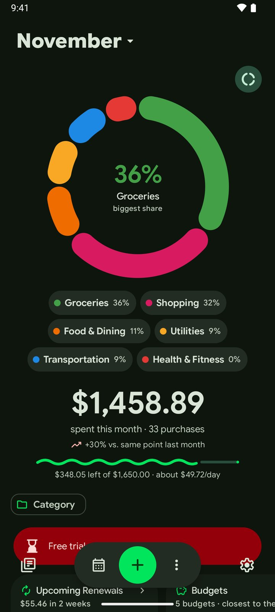
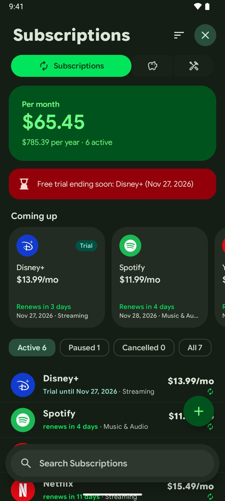
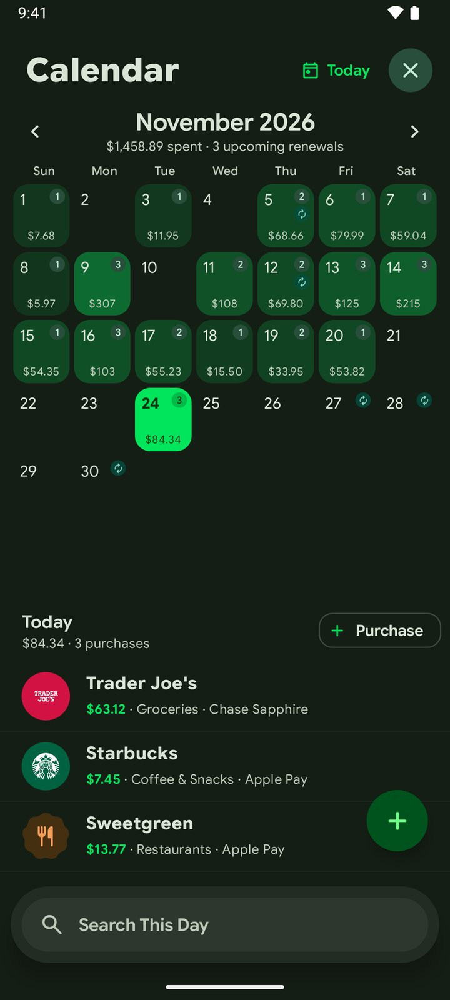

<p align="center"></p>

<h1 align="center">mi. Budget</h1>

<p align="center">
  <strong>Your purchases, budgets and subscriptions, private on your phone.</strong>
</p>

<p align="center">
  <a href="https://github.com/mi-app-hub/mi-budget/releases/latest"></a>
  
  
  
  <a href="LICENSE"></a>
</p>

<p align="center">
  
  
  
</p>

**mi. Budget** shows you this month at a glance: what you've spent, where it went and what's left of your budgets. Scan a receipt or type a purchase in, swipe between months, and keep an eye on subscriptions and free trials before they charge you. Everything stays on your phone: no accounts, no ads, no tracking.

**[Website](https://mi-app-hub.github.io/mi-budget)** · **[User Guide](https://mi-app-hub.github.io/mi-budget/user)** · **[Download](https://github.com/mi-app-hub/mi-budget/releases/latest)**

## Highlights
- **One bar for everything**: a big + adds a purchase, with the calendar and a menu (search, filters, the tools, your renewals and payment methods) beside it, your Library at the left and Settings at the right. Swipe the bar right, left or up and those pages follow your finger in; hold it to search.
- **A purchase's own buttons**: open a purchase or subscription and the bar becomes its buttons (Delete, Refund, Edit). Swipe it right to go back, with the page following your finger.
- **Charts that read at any size**: donut, pie, rings, bars or trend. Small categories still get a proper segment; touch and hold a slice to preview it.
- **Scanning on the phone**: receipts, banking screenshots and pump screens, read on-device, with Gemini Nano on phones that have it.
- **Subscriptions and trials**: monthly and yearly totals, renewal reminders, payments that log themselves, and a warning before a free trial starts charging.
- **Budgets and categories** you can nest as deep as you like, with weekly to yearly budgets that roll up.
- **Refunds**, in full or in part: only what you kept counts. Swipe a purchase right to refund it or left to delete it, with Undo for both.
- **Nothing is lost**: deleting shows Undo, and deleted purchases and subscriptions wait in Recently Deleted for 30 days.
- **Tools**: check splitter, tip calculator, an offline currency converter, and a This Month widget.
- **Material 3 Expressive**: dark, light or Pure Black, seven accents or your wallpaper's colours, font, corners and spacing your way. Hide it from screenshots if you like.
- **Backups are files you keep**: back up everything (receipt photos included) to a `.mibudgetdata` file and restore it on any phone.

See everything mi. Budget does in the **[User Guide](https://mi-app-hub.github.io/mi-budget/user)**.

## Install
Download `mi-budget-<version>-release.apk` from the **[latest release](https://github.com/mi-app-hub/mi-budget/releases/latest)** and open it on your phone (Android 8.0 or newer). mi. Budget checks for updates itself (Settings › About › Check for Updates) and shows what's new after each one; your data stays.

Coming from Budgey? It's a separate app: export a backup in Budgey (Settings › Your Data › Export), then restore it in mi. Budget (Settings › Backup & Reset › Restore).

## Build from source
Requires Android Studio, or JDK 17+ with the Android SDK.

```bash
git clone https://github.com/mi-app-hub/mi-budget.git
cd mi-budget
./gradlew :app:installDebug         # build and install mi. Budget dev beside the release
./gradlew :app:testDebugUnitTest    # run the unit tests
```

How the code is organized is in the **[Developer Guide](https://mi-app-hub.github.io/mi-budget/developer)** and [docs/DEVELOPMENT.md](docs/DEVELOPMENT.md). The website lives in [`docs/`](docs) (Next.js); its colours are generated from the app's default accent by `docs/scripts/theme.mjs`, and `npm run deploy` there publishes it to GitHub Pages.

## More mi. Apps
- [mi. Browser](https://github.com/mi-app-hub/mi-browser): a simple, private browser built around one Pill.
- [mi. Notes](https://github.com/mi-app-hub/mi-notes): notes in folders on one calm page.
- [mi. Edits](https://github.com/mi-app-hub/mi-edits): a simple, private video and audio editor.
- [mi. Sports](https://github.com/mi-app-hub/mi-sports): live scores for the teams, players and leagues you follow.
- [mi. Weather](https://github.com/mi-app-hub/mi-weather): every detail of the weather where you are, all inside the app.

## License
[MIT](LICENSE). mi. Budget collects no personal data: see the [Privacy Policy](https://mi-app-hub.github.io/mi-budget/privacy). Bundled assets keep their own licences: Google Sans Flex (SIL Open Font License) and Material Symbols (Apache 2.0). Brand logos come from [Simple Icons](https://simpleicons.org) (CC0) and open icon sets via [Iconify](https://iconify.design); trademarks belong to their owners. Exchange rates come from [Frankfurter](https://frankfurter.dev). On-device AI: Gemini Nano (built into supported phones).
